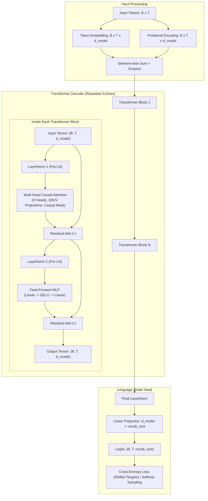

live demos video link
https://drive.google.com/file/d/1424XsC5sr9ogTGqLArs2wSZvw4TyRtnj/view?usp=sharing

https://medium.com/@k230069/roi-of-training-an-llm-from-scratch-what-it-costs-and-where-fine-tuning-wins-c930b2fe1e29


## 📖 Table of Contents
1. [Architecture & Design](#architecture--design)
2. [Starter Repository Structure](#starter-repository-structure)
3. [Setup & Installation](#setup--installation)
4. [Dataset Source](#dataset-source)
5. [Running Unit Tests](#running-unit-tests)
6. [Training MiniGPT](#training-minigpt)
7. [Inference (CLI & REST API)](#inference-cli--rest-api)
8. [Experiments & Ablation Study](#experiments--ablation-study)
9. [Hand Calculations Summary](#hand-calculations-summary)
10. [Known Limitations & Failure Modes](#known-limitations--failure-modes)

---

## Architecture & Design



### Text Architecture Overview

```
Input Tokens: (B, T)
      │
      ├──> Token Embedding: (B, T, d_model)
      └──> Positional Encoding: (B, T, d_model)
      │
      ▼ (Sum + Dropout)
      ┌──────────────────────────────────────────────────┐
      │  Transformer Block (Repeated N=4 times)          │
      │  ┌────────────────────────────────────────────┐  │
      │  │ Input Tensor x                             │  │
      │  │   │                                        │  │
      │  │   ├──> LayerNorm 1 (Pre-LN)                │  │
      │  │   │      └──> Multi-Head Causal Attention   │  │
      │  │   ▼             (4 Heads, causal mask)     │  │
      │  │  (+) Residual Add <────────────────────────┘  │
      │  │   │                                           │
      │  │   ├──> LayerNorm 2 (Pre-LN)                   │
      │  │   │      └──> Feed-Forward MLP (GELU)         │
      │  │   ▼                                           │
      │  │  (+) Residual Add <────────────────────────┘  │
      │  └────────────────────────────────────────────┘  │
      └──────────────────────────────────────────────────┘
      │
      ▼ Final LayerNorm
      │
      ▼ Linear Head (d_model -> vocab_size=65)
      │
    Logits: (B, T, vocab_size)
```

MiniGPT implements the complete modern Transformer decoder pipeline:
- **Deterministic Character Tokenizer:** 65 unique vocabulary characters extracted from Tiny Shakespeare.
- **Sinusoidal & Learned Positional Encoding:** Injects sequence order via geometric frequency waves ($PE(pos, 2i) = \sin(pos/10000^{2i/d})$).
- **Multi-Head Self-Attention:** $H$ independent attention heads with explicit linear projections, scaled dot-product scores, and head concatenation.
- **Strict Causal Masking:** Lower-triangular masking ensuring token $t$ never attends to tokens $> t$.
- **Pre-LayerNorm & Residual Highways:** Stable gradient propagation during training from scratch.
- **Position-wise FFN:** Two-layer projection with GELU non-linearity ($4 \times d_{\text{model}}$).
- **Language Model Head:** Projects hidden representations back to vocabulary logits with optional weight tying.

---

## Starter Repository Structure

```
transformer-gpt-assignment/
├── README.md                           # Documentation, setup & commands
├── requirements.txt                    # Project dependencies
├── conftest.py                         # Pytest environment configuration
├── configs/
│   └── tiny_gpt.yaml                   # Hyperparameter configuration
├── data/
│   ├── README.md                       # Dataset documentation
│   ├── prepare_data.py                 # Dataset downloader script
│   └── input.txt                       # Tiny Shakespeare corpus (~1.11 MB)
├── notebooks/
│   └── colab_demo.ipynb                # One-click Google Colab demo
├── src/
│   ├── __init__.py                     # Package initialization
│   ├── tokenizer.py                    # CharTokenizer class (deterministic encode/decode)
│   ├── dataset.py                      # TextDataset with shifted next-token targets
│   ├── attention.py                    # Scaled dot-product, SelfAttention, MultiHeadedAttention
│   ├── positional_encoding.py          # Sinusoidal & Learned Positional Encodings
│   ├── transformer_block.py            # TransformerBlock, Pre-LN, FeedForward MLP
│   ├── gpt.py                          # MiniGPT full causal language model
│   ├── train.py                        # Full training loop, evaluation, checkpointing
│   ├── generate.py                     # CLI text generation matching Section 12.1
│   ├── api.py                          # FastAPI REST API for deployment
│   └── utils.py                        # Seed, checkpointing, loss plotting utilities
├── tests/
│   ├── test_attention.py               # Hand-calculation test & attention unit tests
│   ├── test_mask.py                    # Causal masking & gradient isolation tests
│   ├── test_shapes.py                  # End-to-end tensor-shape tracing
│   └── test_overfit.py                 # Tiny overfit sanity check
├── experiments/
│   ├── attention_visualization.py      # Generates Figure 2 (causal mask) & Figure 7 (attention map)
│   ├── ablation.py                     # Depth, heads, context, and positional ablations (Figure 9)
│   └── evaluate.py                     # Model evaluation, perplexity, and parameter count (Figure 5 & 8)
├── outputs/
│   ├── figures/                        # Generated figures (loss curve, attention, ablations)
│   ├── logs/                           # Training logs
│   └── samples/                        # Generated sample completions
├── checkpoints/
│   ├── tiny_gpt_best.pt                # Trained model weights checkpoint
│   └── tokenizer.json                  # Persisted vocabulary mapping
└── report/
    └── report.md                       # Full 8-12 page Technical Report (Medium Article)
```

---

## Setup & Installation

### 1. Clone the repository
```bash
git clone https://github.com/mjohnraza/mini.git
cd mini
```

### 2. Create and activate a virtual environment
```bash
python -m venv venv
# On Windows:
.\venv\Scripts\activate
# On Linux/macOS:
source venv/bin/activate
```

### 3. Install dependencies
```bash
pip install -r requirements.txt
```

---

## Dataset Source

Download the **Tiny Shakespeare** dataset (~1.11 MB, ~40,000 lines from Shakespeare plays):
```bash
python data/prepare_data.py
```
This downloads `data/input.txt` directly from the official repository.

---

## Running Unit Tests

Run the complete test suite to verify mathematical correctness, shapes, and causal isolation:
```bash
python -m pytest -v
```
All 8 tests will pass:
1. `test_hand_calculated_attention_step_by_step` (verifies Section 6 arithmetic against code)
2. `test_self_attention_module` (verifies projection, softmax distribution sum = 1)
3. `test_multi_head_attention` (verifies head split, concatenate, output shape)
4. `test_causal_mask_structure` (verifies lower-triangular matrix)
5. `test_future_tokens_receive_zero_attention` (verifies future weight strictly = 0.0)
6. `test_causal_gradient_isolation` (verifies zero gradient backpropagation from future tokens)
7. `test_tiny_overfit_batch` (verifies loss reduction > 70% on repeated batch)
8. `test_tensor_shape_trace_full_pipeline` (verifies all tensor transitions)

---

## Training MiniGPT

To train MiniGPT on the Tiny Shakespeare dataset:
```bash
python -m src.train --config configs/tiny_gpt.yaml --steps 1000
```
- Logs are saved to `outputs/logs/train.log`.
- Best checkpoint is automatically saved to `checkpoints/tiny_gpt_best.pt`.
- Loss curves are plotted and saved to `outputs/figures/loss_curve.png`.
- 5 fixed prompt completions are saved to `outputs/samples/samples.txt`.

---

## Inference (CLI & REST API)

### Command-Line Interface (Section 12.1 Format)
Generate text autoregressively with custom prompt and temperature:
```bash
python -m src.generate --prompt "ROMEO:\nWhat light through" --max-new-tokens 80 --temperature 0.8
```
**Expected Terminal Output:**
```
Prompt: ROMEO:\nWhat light through
Generated: ROMEO:\nWhat light through yonder window breaks? It is the east, and Juliet is the sun...

model parameters: 0.81M (809,984)
context length: 128
temperature: 0.8
```

### FastAPI REST Server
Start the local REST server:
```bash
python -m uvicorn src.api:app --host 0.0.0.0 --port 8000
```
Interactive Swagger documentation is available at `http://localhost:8000/docs`.

**Test via cURL:**
```bash
curl -X POST "http://localhost:8000/generate" \
     -H "Content-Type: application/json" \
     -d '{"prompt": "JULIET:\n", "max_new_tokens": 80, "temperature": 0.8}'
```

---

## Experiments & Ablation Study

Run the automated ablation experiments (Section 13):
```bash
python -m experiments.ablation
```
This tests:
- **Depth:** 2 vs 4 vs 6 layers
- **Attention Heads:** 2 vs 4 vs 8 heads
- **Context Length:** 64 vs 128 vs 256 tokens
- **Positional Method:** Sinusoidal vs Learned

To visualize causal masks and trained attention weight distributions:
```bash
python -m experiments.attention_visualization
```

---

## Hand Calculations Summary

See [`report/report.md`](file:///c:/Users/exam.DESKTOP-LNCC6CA/Desktop/ai%20assignment/report/report.md#L20-L100) for complete step-by-step arithmetic:
- **Explicit Matrices:** $Q \in \mathbb{R}^{3 \times 2}, K \in \mathbb{R}^{3 \times 2}, V \in \mathbb{R}^{3 \times 2}$
- **Scaling:** $S = \frac{Q K^T}{\sqrt{2}}$
- **Causal Mask:** $S_{\text{masked}} = S + (1 - M)(-\infty)$
- **Weights:** $A_{\text{causal}} = \text{softmax}(S_{\text{masked}})$
- **Weighted Values:** $\text{Out} = A_{\text{causal}} V$

---

## Known Limitations & Failure Modes

1. **Character-Level Tokenization:** Character modeling causes occasional morphological hallucinations on rare words. Subword tokenization (BPE) would yield higher token compression and cleaner vocabulary representations.
2. **Low-Temperature Repetition Loops:** Under greedy decoding ($T \to 0$), the model may generate repetitive loops. Top-k filtering ($k=40$) and temperature $T \in [0.7, 0.9]$ are recommended.
