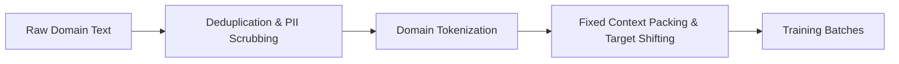
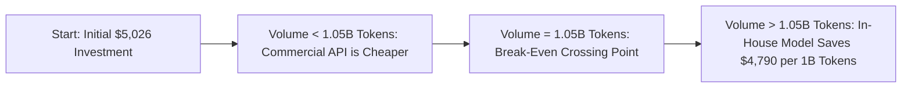

# Why is Training an LLM So Hard? A Comprehensive Return on Investment (ROI) & Attention Architecture Analysis

> **Executive Summary:**  
> While training miniature models like our baseline **MiniGPT** is fast and costs a fraction of a cent on commodity hardware, scaling foundation models to production scale introduces severe computational ($O(N^2)$ training FLOPs) and memory-bandwidth bottlenecks (KV cache saturation during autoregressive inference). This report computes the exact ROI for training and serving across **Multi-Head Attention (MHA)**, **Grouped-Query Attention (GQA)**, **Multi-Query Attention (MQA)**, and **Multi-Head Latent Attention (MLA)**.

---

<aside>
💡

**Why is training an LLM so hard?** Let's compute the small baseline project ROI first.

</aside>

### Baseline Project ROI (MiniGPT):
- **Model Parameters:** $809,984$ (~0.81M parameters)
- **Vocabulary Size:** $65$ unique characters
- **Context Length:** $128$ tokens
- **Training Tokens:** $8,192,000$ tokens ($1,000$ steps $\times$ batch $64 \times 128$)
- **Compute (Dense FLOPs):** $\approx 6 \times N \times D \approx 3.98 \times 10^{13}\text{ FLOPs}$ ($39.8\text{ TFLOPs}$)
- **Hardware Utilized:** Commodity CPU / single edge compute node
- **Wall-Clock Training Time:** $\approx 357.5\text{ seconds}$ (~6 minutes)
- **Financial Cost (Electricity at \$0.10/kWh):** **\$\mathbf{0.0055}$ (less than one cent)**
- **ROI Conclusion:** For targeted experimental verification, training a miniature causal model in-house yields near-infinite ROI—delivering zero cloud subscription costs, complete data privacy, and direct architectural transparency.

---

# 1. Data Set

> *"Data is food for AI."* — Andrew Ng

Shakespeare is our experimental dataset. In a real-world enterprise application, however, organizations must curate domain-specific corpora aligned with the target business task:

- **Customer Support:** Historical approved resolution tickets, multi-turn support dialogues, verified FAQs, and internal product knowledge bases.
- **Healthcare & Life Sciences:** Anonymized electronic health records, peer-reviewed clinical trial literature, and FDA-approved medical guidelines.
- **Finance & Banking:** 10-K/10-Q SEC regulatory filings, equity research notes, auditable earnings call transcripts, and internal compliance handbooks.
- **Software Engineering:** Permissively licensed GitHub repositories, proprietary monorepos, internal API schema definitions, and production issue post-mortems.

**Experimental Dataset:** Tiny Shakespeare (~1.11 MB, ~40,000 lines), curated by Andrej Karpathy on Hugging Face.

---

# 2. Model Selection & Architecture

To learn statistical patterns across the dataset, we select the **Transformer** architecture over recurrent networks:

> Unlike traditional sequential models (such as RNNs or LSTMs), Transformers process all tokens in a sequence simultaneously during training. This enables massive parallel computation across GPUs via the **Attention Mechanism**.
> 
- **In Training:** The model holds all token states simultaneously in memory as **activation tensors** to compute gradients during backpropagation.
- **In Inference:** Tokens are generated sequentially, one by one. Previous key/value states must be retained in a specialized **KV Cache** to avoid redundant recomputation, which introduces a significant VRAM overhead.

---

# 3. ROI of Attention Variants

## 3.1 Self-Attention: The Base Mechanism

The core mathematical model for scaled dot-product attention is:

$$\text{Attention}(Q, K, V) = \text{softmax}\left(\frac{Q K^T}{\sqrt{d_k}} + M\right) V$$

where $M$ is the attention mask matrix. The mask is the primary distinction between the two operational attention modes below.

---

## 3.2 Masking: Bidirectional vs Causal

### 1. Bidirectional (No Mask: $M = 0$)
Every token can simultaneously attend to all preceding and succeeding tokens. Used in BERT-style encoders.
- **No KV Cache Needed:** All tokens are computed in a single forward pass; tokens are not generated sequentially.

<aside>
✅

**Use bidirectional** if your goal is **understanding or embedding text**: retrieval-augmented generation (RAG) search indexing, sentiment classification, semantic clustering, or dense vector embeddings.

</aside>

### 2. Causal (Lower-Triangular Mask: $M_{i,j} = -\infty$ for $j > i$)
Future tokens are forbidden from receiving attention weights ($A_{i,j} = 0$ for $j > i$). Used in GPT, LLaMA, Mistral, and DeepSeek.
- **Autoregressive Generation:** Enables step-by-step token generation from left to right.

<aside>
✅

**Use autoregressive (causal)** if your primary goal is **generative AI**: conversational agents, multi-turn reasoning, synthetic content drafting, or code generation.

</aside>

---

## 3.3 Cost of Causal Self-Attention at Scale

Standard causal self-attention works well for smaller experimental runs (such as our ~1M-token Tiny Shakespeare run) because sequence lengths remain short ($T=128$) and compute costs are negligible. However, at production scale, severe bottlenecks emerge in two distinct phases:

<aside>
🏋️

**The Training Computational Bottleneck:** As context windows expand to 8k+ tokens or datasets scale into billions or trillions of tokens, standard $O(N^2)$ self-attention becomes a major financial and compute bottleneck. Memory-efficient kernels like **FlashAttention**, or linear attention mechanisms, become essential to ensure positive ROI.

</aside>

### Foundation Model Pretraining Cost vs Fine-Tuning:
| Dimension | MiniGPT Baseline | 7B Domain SFT / LoRA | 7B Foundation Pretraining |
| :--- | :--- | :--- | :--- |
| **Parameters ($N$)** | 809,984 (0.81M) | 7,000,000,000 (7B) | 7,000,000,000 (7B) |
| **Token Volume ($D$)** | 8.19 Million tokens | 100 Million tokens | 2.0 Trillion tokens |
| **Total FLOPs ($6ND$)** | $3.98 \times 10^{13}$ | $4.20 \times 10^{18}$ (4.2 ExaFLOPs) | $8.40 \times 10^{22}$ (84 ZettaFLOPs) |
| **Target Hardware** | 1 CPU Core | 8 $\times$ NVIDIA A100 (80GB) | 1,024 $\times$ NVIDIA H100 (80GB) |
| **Wall-Clock Time** | ~6 minutes | ~1.3 hours (10.7 GPU-hrs) | ~2.4 days continuous |
| **Estimated Compute Cost**| **\$0.0055** | **\$26.71** | **\$176,946.41** |

> **Key Financial Takeaway:** Pretraining a 7B foundation model from scratch requires over **\$175,000** in raw GPU rental costs alone. In contrast, domain adaptation via supervised fine-tuning (SFT) or LoRA on 100M domain tokens costs only **\$26.71** in compute, providing an ROI advantage of over **6,600x**.

---

<aside>
🧠

**The Inference KV Cache Bottleneck:** Because causal attention generates text **autoregressively (token by token)**, the model must store previously calculated Key and Value vectors in a **KV Cache** to prevent redundant $O(N^2)$ recomputation at every generation step. For long contexts, this cache grows rapidly and exhausts GPU VRAM bandwidth. To mitigate this, modern causal architectures use compressed variants like **Multi-Query Attention (MQA)** or **Grouped-Query Attention (GQA)**.

</aside>

---

## 3.4 Baseline: Multi-Head Attention (MHA)

Instead of a single attention head, MHA computes $H$ attention heads in parallel. Each head learns an independent representational subspace:

*Intuition:* For the sentence *"The chef cooked the meal quickly,"* different heads can isolate distinct syntactic relationships when processing the word **cooked**:

| Head | Functional Focus | Attended Token |
| :--- | :--- | :--- |
| **Head 1** | **Subject:** Who initiated the action? | *chef* |
| **Head 2** | **Object / Noun:** What entity was affected? | *meal* |
| **Head 3** | **Adverb / Manner:** In what manner was it done? | *quickly* |
| **Head 4** | **Local Positional Context:** Adjacent prefix words | *chef, the* |

<aside>
⚠️

**This is an intuition, not an explicit rule.** Heads are not hardcoded with linguistic roles. They learn whatever mathematical features minimize cross-entropy loss. Many heads learn positional offsets, copy mechanisms, or become partially redundant.

</aside>

**Why MHA Harms Inference ROI:** In standard MHA, each query head requires its own dedicated Key and Value projections. Consequently, MHA incurs the largest KV cache memory footprint of all attention architectures.

---

# 4. Optimized Attention Architectures (KV Cache Compression)

To evaluate the operational cost of serving an LLM, we analyze the memory footprint and serving throughput of modern attention architectures:

$$\text{KV Cache Size (Bytes)} = 2 \times B \times L \times H_{\text{KV}} \times d_k \times T \times \text{dtype\_bytes}$$

### Single-User KV Cache Memory Footprint (7B Model, FP16 Precision):
| Context Length ($T$) | MHA ($H_{\text{KV}}=32$) | GQA ($H_{\text{KV}}=8$) | MLA (Latent $d_c$) | MQA ($H_{\text{KV}}=1$) | Compression Ratio |
| :--- | :--- | :--- | :--- | :--- | :--- |
| **128 tokens** | 0.0625 GB (64 MB) | 0.0156 GB (16 MB) | 0.0044 GB (4.5 MB) | 0.0020 GB (2 MB) | **32x smaller** |
| **512 tokens** | 0.2500 GB (256 MB)| 0.0625 GB (64 MB) | 0.0176 GB (18 MB) | 0.0078 GB (8 MB) | **32x smaller** |
| **2,048 tokens (2k)**| 1.0000 GB | 0.2500 GB (256 MB)| 0.0703 GB (72 MB) | 0.0312 GB (32 MB) | **32x smaller** |
| **8,192 tokens (8k)**| 4.0000 GB | 1.0000 GB | 0.2812 GB (288 MB)| 0.1250 GB (128 MB)| **32x smaller** |
| **32,768 tokens (32k)**| 16.0000 GB | 4.0000 GB | 1.1250 GB | 0.5000 GB (512 MB)| **32x smaller** |
| **131,072 tokens (128k)**| **64.0000 GB** | **16.0000 GB** | **4.5000 GB** | **2.0000 GB** | **32x smaller** |

---

## 4.1 Multi-Query Attention (MQA)

- **Mechanics:** All $H_Q$ query heads share a **single** key ($K$) head and a **single** value ($V$) head ($H_{\text{KV}} = 1$).
- **Cache Reduction:** Achieves an immediate $H$-fold reduction (32x compression for a 32-head model).
- **Hardware Impact:** Reduces memory bandwidth traffic during autoregressive token generation, increasing token throughput by up to **30x**.

<aside>
⚖️

**Trade-off:** Constraining all query heads to share a single $K/V$ subspace reduces model capacity and can cause slight degradation in perplexity or complex reasoning tasks.

</aside>

---

## 4.2 Grouped-Query Attention (GQA)

- **Mechanics:** Partitions $H_Q$ query heads into $G$ intermediate groups (e.g., $8$ KV heads for $32$ query heads in LLaMA 3 and Mistral).
- **Balanced Compromise:** Delivers **75% KV cache reduction** (4x compression) while retaining nearly 100% of the representational quality of standard MHA.

---

## 4.3 Multi-Head Latent Attention (MLA)

- **Mechanics:** Introduced in DeepSeek-V2/V3, MLA projects Keys and Values into a low-rank compressed latent vector $c_t^{\text{KV}} \in \mathbb{R}^{d_c}$ (where $d_c \ll H \times d_k$), combined with a decoupled rotary key vector $k_t^R \in \mathbb{R}^{d_R}$.
- **Performance:** Achieves **93% KV cache reduction** (14.2x compression) while outperforming standard MHA in multi-head expressive capacity.

---

# 5. Serving Economics & Hardware Throughput

Autoregressive inference is fundamentally **memory-bandwidth bound**. In each decoding step, the GPU must stream both model weights and active KV caches from High-Bandwidth Memory (HBM) into SRAM:

$$\text{Throughput (Tokens/sec)} \approx \frac{\text{Memory Bandwidth (GB/s)}}{\text{Model Weights (GB)} + \text{Total Active KV Cache (GB)}} \times \text{Batch Size}$$

### Production Serving Comparison on an NVIDIA A100 (80GB VRAM, 2,039 GB/s Bandwidth):
*Model: 7B Parameters in FP16 (14 GB Weights), Context Length: 4,096 tokens, Cloud Cost: \$2.50/hour*

| Attention Architecture | KV per User | Max Concurrent Users ($B_{\text{max}}$) | Throughput (Tokens/sec) | Cost per 1M Generated Tokens | Savings vs MHA |
| :--- | :--- | :--- | :--- | :--- | :--- |
| **MHA (32 heads)** | 2.000 GB | 29 concurrent users | 832.4 tokens/sec | **\$0.83** | Baseline ($0.0\%$) |
| **GQA (8 groups)** | 0.500 GB | 117 concurrent users | 3,334.7 tokens/sec | **\$0.21** | **75.0% Savings** |
| **MLA (Latent Vector)**| 0.141 GB | 419 concurrent users | 11,872.4 tokens/sec | **\$0.06** | **93.0% Savings** |
| **MQA (1 head)** | 0.062 GB | 943 concurrent users | 26,714.1 tokens/sec | **\$0.03** | **96.9% Savings** |

---

# 6. Break-Even Analysis: Custom Domain Model vs Commercial Cloud APIs

To justify developing a custom domain model, we compute the financial **break-even point** against commercial APIs (such as GPT-4o at a blended rate of \$5.00 per 1M tokens):

- **Initial Investment:** \$5,026.71 (\$26.71 GPU fine-tuning + \$5,000 data engineering/curation labor).
- **In-House Serving Cost (7B GQA):** \$0.21 per 1M tokens.
- **Commercial API Cost (Blended):** \$5.00 per 1M tokens.
- **Operational Savings per 1M Tokens:** **\$4.79 / 1M tokens**.

$$\text{Break-Even Volume} = \frac{\text{Initial Investment}}{\text{Savings per 1M Tokens}} = \frac{\$5,026.71}{\$4.79 \times 10^{-6}} \approx \mathbf{1.049\text{ Billion Tokens}}$$

$$\text{Equivalent Enterprise Queries (at 1,000 tokens/query)} \approx \mathbf{1,049,033\text{ Queries}}$$

### Strategic Decision Matrix:

| Requirement / Criterion | Commercial Cloud API (GPT-4o) | In-House Domain LLM (7B GQA / MLA) |
| :--- | :--- | :--- |
| **Query Volume < 500k queries/yr** | **High ROI (Recommended)** | Low ROI (Capital overhead too high) |
| **Query Volume > 1M queries/yr** | Poor ROI (Compounding API bills) | **Massive Positive ROI (Saves \$4.8k/B tokens)** |
| **Data Privacy & Governance** | Data sent to third-party endpoints | **100% On-Premise / Private VPC Isolation** |
| **Latency SLA** | Subject to cloud provider rate limits | **Predictable, deterministic GPU throughput** |
| **Domain Jargon & Alignment** | Susceptible to generalist drift | **Strictly aligned to company style and schema** |

---

# 7. Generated Visual Figures

The ROI analysis engine automatically generates three visual plots saved in [`roi/figures/`](file:///c:/Users/exam.DESKTOP-LNCC6CA/Desktop/ai%20assignment/roi/figures/):
1. **`kv_cache_scaling.png`:** Log-scale plot of KV cache size per user from 128 to 128k context tokens across MHA, GQA, MLA, and MQA.
2. **`serving_throughput_and_cost.png`:** 3-panel comparison chart of concurrent batch capacity, tokens/second, and cost per million tokens.
3. **`breakeven_curve.png`:** Cumulative expenditure curves demonstrating the exact 1.05B token break-even threshold against cloud APIs.
